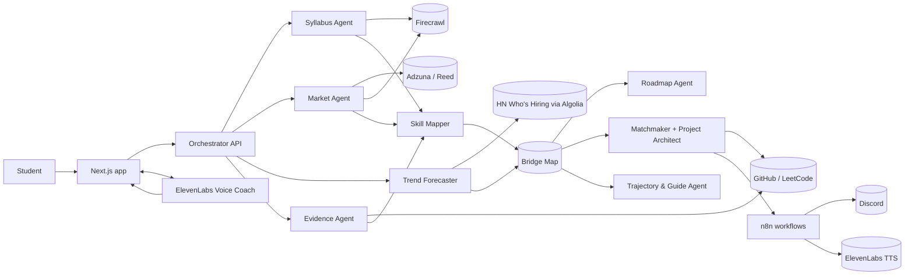

# Keystone

**Your degree is the foundation. Keystone builds the bridge to industry.**


Keystone is a team of AI agents. It reads your university's syllabus, what industry is hiring for right now, and what you've actually built. Then it gives you a roadmap that builds on your degree instead of repeating it, a study pod to learn with, and seniors to learn from.

Built at **GreatUniHack 2026** (University of Manchester) for Reply's **"AI on Campus"** challenge (Student Tech Clash).

**Team docs:** start with [`docs/team/00-shared-contract.md`](docs/team/00-shared-contract.md) (the contract wins), then your own `docs/team/P<N>-*.md`.

---

## The problem

Universities teach theory, mostly alone, from a syllabus that updates every few years. Industry hires for practical teamwork and skills that change every few months.

The Institute of Student Employers' **2025 Student Development Survey of 148 employers** found:

- **77%** say graduates who did an internship or placement arrive with better skills and attitudes. Practical experience makes the difference, and most students never get it.
- Concern about graduates' **verbal communication rose to 42%** (from 29% in 2024), and **46%** are concerned about **written communication**. The missing piece is working in teams.
- **48%** worry that AI use in recruitment **misrepresents students' abilities**. Self-reported skills are losing trust, so proof matters.

So students:
1. **can't see the gap** between their degree and the jobs they want;
2. **learn the hard way**, paying for courses on topics their own Semester 2 module will teach;
3. **fall behind industry**, because fast-rising skills take years to reach a syllabus;
4. **practise alone**, while jobs need code review and communication;
5. **start unequal**: first-generation, international and commuter students and career changers often have no one to ask.

## The solution

One knowledge graph, the **Bridge Map**, joins three things that live in separate places today:

```
   YOUR DEGREE                    INDUSTRY                       YOU
(syllabus via Firecrawl)   (live job ads + hiring history)   (GitHub and more)
          \                          |                          /
           \_______________ BRIDGE MAP (knowledge graph) ______/
                                     |
      each skill is marked: proven · covered by your degree (with semester)
                            gap your degree won't cover · rising in industry
                                     |
                Personal roadmap -> study pod + project -> proof -> repeat
```

- **Bridge Map and readiness score.** In our demo, first-year Aisha is 38% ready for ML engineer roles today, and 84% by September 2027 if she follows her roadmap.
- **A roadmap with receipts.** It skips what your degree will teach you soon, and every task says why: in our demo, "Docker appears in 41% of ML engineer ads, and none of your modules teach it."
- **Industry Radar.** Skill demand per role from job ads, plus a 12-month trend forecast with an uncertainty band.
- **Study pods (learning by teaching).** Pods of 3–4 where each person is strong in someone else's gap. Every match is explained, and the pod gets a real project repo with an issue for each person.
- **Trajectories (near-peer mentoring).** See where students before you went, and ask a senior for 15 minutes.
- **AI mock interview.** An ElevenLabs voice interviewer asks about your own pod project, then scores your answers.
- **Agent Activity panel.** Watch the agents work together, step by step.

### How it fits Reply's challenge

| Reply asks for | Keystone |
|---|---|
| Level 1 (required): the idea, pitched in 60 seconds | Our 60-second pitch, delivered to Reply |
| Level 2 (required): a working AI agent | Nine agents and an orchestrator, live in the Agent Activity panel |
| Level 3 (optional): multi-agent system | Yes: nine agents with separate jobs (table below) |
| Level 3 (optional): knowledge graph | Yes: the Bridge Map (schema below) |
| Level 3 (optional): launch campaign | Yes: "Bridge Week" at Manchester, at `/launch` |
| Pillar: **Learning** | Degree-aware roadmap, study pods, module-to-industry translator |
| Pillar: **Teaching** | Learning by teaching: in each pod, the student strong in a skill reviews the teammate learning it |
| Pillar: **Assessment** | Skills proven by evidence, not self-claimed; scored mock interviews |

## Architecture



### The Bridge Map (knowledge graph)

```
(Student)-[:HAS_EVIDENCE]->(Evidence {source, url, date})-[:DEMONSTRATES {level, confidence}]->(Skill)
(Programme)-[:HAS_MODULE]->(Module {code, year, semester})-[:TEACHES {level}]->(Skill)
(Role)-[:REQUIRES {weight, snapshot_date}]->(Skill)
(Skill)-[:PREREQ_OF]->(Skill)          (Skill)-[:CO_OCCURS {lift}]->(Skill)
(Skill)-[:HAS_TREND {month, share}]->(TrendPoint)
(Student)-[:MEMBER_OF {learns:[Skill], teaches:[Skill]}]->(Pod)-[:BUILDS]->(Project)-[:EXERCISES]->(Skill)
(Student)-[:FOLLOWED]->(Trajectory)-[:LED_TO]->(Role)
(Student)-[:WANTS]->(Role)
```

Each student's map is built from their syllabus, the market data and their evidence, and kept in the shared document store (Supabase Postgres, or in memory in demo mode). A canonical list of 123 skills (`data/skills.json`) keeps every agent consistent.

**Readiness** = Σ (demand weight × coverage) ÷ Σ demand weight, where proven = 1.0, completed module = 0.7, upcoming module = 0.4 and gap = 0.

## Agents

| # | Agent | What it does | Tools | Code | Owner |
|---|---|---|---|---|---|
| 0 | **Orchestrator** | Runs the other agents and streams their progress to the Activity panel | Server-sent events | `lib/agents/orchestrator.ts` | P2 |
| 1 | **Syllabus Agent** | Turns programme pages into modules: year, semester, topics, learning outcomes | Firecrawl search, crawl, JSON extraction | `lib/agents/syllabus.ts` | P1 |
| 2 | **Skill Mapper** | Maps syllabus, job-ad and evidence text onto canonical skills, with a level | Skill taxonomy, LLM | `lib/agents/skillmap.ts` | P1 |
| 3 | **Market Agent** | Skill demand per role, salaries, top hiring companies | Adzuna, Reed, Firecrawl | `lib/agents/market.ts` | P1 |
| 4 | **Trend Forecaster** (code, not an LLM) | Monthly skill share, trend, and a 12-month projection with an uncertainty band | HN "Who is hiring?" via Algolia, regression | `lib/agents/trends.ts` | P1 |
| 5 | **Evidence Agent** | Judges skill levels from real work, quoting the file that justifies each one | GitHub API, LeetCode | `lib/agents/evidence.ts` | P2 |
| 6 | **Roadmap Agent** | A week-by-week plan with a receipt for every task; skips what your degree will teach | Bridge Map, Learning DNA | `lib/agents/roadmap.ts` | P2 |
| 7 | **Matchmaker + Project Architect** | Forms pods with explained matches; writes a brief and creates a repo with issues | Matching algorithm, GitHub API | `lib/agents/matchmaker.ts`, `architect.ts` | P5 |
| 8 | **Trajectory & Guide Agent** | Finds similar journeys and public practitioners; drafts requests the student sends | Similarity search, GitHub user search | `lib/agents/trajectories.ts`, `guides.ts` | P5 |
| 9 | **Voice Coach** | AI mock interview with scored feedback; voice onboarding; weekly audio briefing | ElevenLabs Agents + TTS, Keystone tool webhooks | `lib/voice/`, `lib/briefing.ts` | P4 |
| – | AI Tech Lead | Socratic review on pod pull requests: hints, not answers | GitHub webhooks | `lib/agents/techlead.ts` | P5 |

## Sponsor tech

| Tech | What we use it for | Where |
|---|---|---|
| **Firecrawl** | Crawls the University of Manchester programme pages and extracts structured JSON with a schema; fetches full job-ad text | `lib/connectors/firecrawl.ts` |
| **n8n** | Workflows that connect Keystone to Discord, ElevenLabs and the job market (below) | `n8n/*.json` |
| **ElevenLabs** | The voice mock interviewer, the voice onboarding coach, and text-to-speech for the weekly briefing | `lib/voice/`, `components/voice/`, `n8n/W2-monday-briefing.json` |
| **OpenAI** (keys from Reply) | Structured outputs for the LLM agents, validated with zod | `lib/llm.ts` |

Also used: Adzuna API (job ads and salaries), GitHub API, Supabase, Recharts.

| n8n workflow | Trigger | What it does | Status |
|---|---|---|---|
| W1 Market refresh | Sunday 22:00, or manual | Refreshes job-ad data; asks Keystone to re-plan roadmaps when a skill moves more than 10% | Built |
| W2 Monday briefing | Monday 08:00, or manual | Briefing API → ElevenLabs text-to-speech → MP3 posted to Discord | Built |
| W3 Pod kickoff | Webhook from "Start project" | Posts the pod's brief, repo and members to Discord (webhook or a new `pod-…` channel) | Built |
| W4 Pod nudge | Daily | Nudges idle pods with their smallest next issue | Designed |
| W5 Opportunity watcher | Daily | Matches internships, hackathons and events to roadmaps | Designed |
| W6 Newcomer welcome | New sign-up with the New to UoM badge | Welcome message, first-week checklist, buddy | Designed |

Import a workflow: n8n → Workflows → Import from file. Credentials are stripped; see [`n8n/README.md`](n8n/README.md).

## How to run

You need **Node 22** and **npm**.

```bash
npm ci
cp .env.example .env.local   # set DEMO_MODE=true to run entirely from fixtures
npm run dev                  # http://localhost:3000/dashboard?demo=1 signs you in as Aisha
```

**Demo mode (no API keys needed).** With `DEMO_MODE=true` every agent serves cached or fixture data instantly. Voice falls back to typed answers when ElevenLabs isn't configured.

**Live mode.** Set `DEMO_MODE=false` and fill in the keys in `.env.local` (see `.env.example`): OpenAI, Firecrawl, Adzuna, GitHub, Supabase, ElevenLabs, n8n and Discord. Never commit real keys.

Useful scripts:

```bash
npm run warm-cache    # pre-fetch syllabus and market data into data/cache/
npm run hn-backfill   # build skill trend history from HN "Who is hiring?" threads
npm run seed          # load demo students and trajectories
```

## Testing

```bash
npm run typecheck && npm run lint && npm test   # Vitest unit, component and API tests
npm run test:e2e                                 # Playwright + axe, runs the app with DEMO_MODE=true
```

The first time you run the end-to-end tests, install the browsers with `npx playwright install`.

## Repository layout

```
app/              pages (onboard, dashboard, map, roadmap, market, pods, trajectories, interview, launch) and API routes
components/       shared UI, plus one folder per area (map, roadmap, market, pods, voice, …)
lib/agents/       the agents and the orchestrator
lib/connectors/   Firecrawl, Adzuna, Reed, HN, GitHub and other platforms
lib/voice/        ElevenLabs interview, scoring and text-to-speech
lib/types.ts      the shared data contract
data/             skills.json, fixtures/, cache/ and seed/ (demo data is labelled)
n8n/              exported workflows (credentials removed)
e2e/              Playwright tests
docs/team/        the team plan and shared contract
```

## Ethics and privacy

- **Opt-in everything:** connected accounts, badges, leaderboards and trajectories. **Private by default.**
- **No scraping of LinkedIn or X.** Only exports the student uploads, public pages and official APIs.
- **Rankings measure growth, not absolute skill.** Momentum compares you with your own past weeks. There are no public "best student" lists, and helping others earns points.
- **Academic integrity:** Keystone never shares solutions to assessed work. Extension projects start after marking.
- **Explainable:** every recommendation has a receipt, and every forecast shows an uncertainty band and says it is a projection.
- **Fair matching:** pods are formed on skills, interests and availability, **never on demographic fields**. Badges are only used to send help.
- **No spam:** Keystone drafts messages; students send them, with a daily limit.
- **Voice privacy:** Keystone stores only the interview transcript, for feedback, never the audio.
- **Demo data is labelled.** The demo students and the 40 trajectories are synthetic, and the app says so.

## Team

| | Role | GitHub |
|---|---|---|
| P1 | Data agents: Syllabus, Market, Skill Mapper, Trend Forecaster, Industry Radar | Bplhansi |
| P2 | Brain: LLM layer, store, orchestrator, Evidence Agent, Bridge Map, Roadmap Agent | |
| P3 | Frontend lead and UX: design system, app shell, onboarding, Bridge Map and Roadmap pages, Activity panel | Violet2601 |
| P4 | Voice, automation and story: ElevenLabs, n8n, interview and launch pages, pitch, video, Devpost | ShivaTeja05 |
| P5 | Community: Matchmaker, Project Architect, Trajectories, badges, Momentum, pods pages | jeevithg090 |

---

## Data agents (P1)

| Data | Where it comes from |
|---|---|
| `data/cache/syllabus-uom-bsc-cs.json` | Real unit codes, titles, credits and mandatory/optional status from the Manchester course page for 2027 entry, via Firecrawl. Semesters come from the last digit of each code. Skills are inferred from unit titles; topics and outcomes were not scraped. |
| `data/cache/trends*.json` | Real: 36 months of Hacker News "Who is hiring?" threads, rebuilt by `npm run hn-backfill` (no key needed). Mostly US and startup jobs, not UK graduate roles. |
| `data/fixtures/market.*.json` | **Invented demo data.** Companies are fictional and links go to example.com. Run `npm run warm-cache` with Adzuna keys to replace it. |

## Brain: graph, evidence and roadmap (P2)

_P2 to add: what runs live, what is cached in demo mode, and known limits._

## Frontend and UX (P3)

_P3 to add: pages, design system and the Activity panel._

## Voice and automation (P4)

| Feature | Where | Live | Without keys / demo mode |
|---|---|---|---|
| **AI mock interview** (`/interview`) | `components/voice/InterviewClient.tsx`, `lib/voice/interviewConfig.ts`, `lib/voice/interviewScoring.ts` | ElevenLabs voice agent via a signed URL; questions built from the student's profile, roadmap and pod project; GPT scores content, structure, clarity and confidence | Typed answers with the same five questions; filler words still counted; neutral scores if no OpenAI key |
| **Voice onboarding coach** | `components/voice/VoiceOnboardButton.tsx` (onboarding slot) | Talk instead of filling the form; the coach calls the `save_dna` client tool and the student confirms before anything is applied | Hidden |
| **Weekly audio briefing** | `lib/briefing.ts`, `/api/briefing/[userId]`, `/api/tts`, `components/voice/BriefingPlayer.tsx` (dashboard slot) | A 60-second script from the roadmap, momentum, trends and pod, read out by ElevenLabs | The written script under "Read instead" |
| **n8n + Discord** | `n8n/`, `lib/n8n.ts`, `/api/n8n/*`, `/api/voice/tools/[tool]` | W3 pod kickoff and W2 Monday briefing post to Discord; W1 re-plans roadmaps when demand moves | `triggerWorkflow` returns `false` and nothing breaks |
| **Bridge Week launch page** (`/launch`) | `components/voice/launch/` | Waitlist stored in the document store | Same |

**Set up voice:** follow [`voice/agents.md`](voice/agents.md), or create both ElevenLabs agents with `node voice/create-agents.mjs --create` (reads `ELEVENLABS_API_KEY` and `ELEVENLABS_VOICE_ID` from `.env.local` and writes the agent ids back). The n8n workflows and Discord set-up are in [`n8n/README.md`](n8n/README.md).

**Tested:** unit, component and route tests for every P4 route and component; the app → n8n → Discord and n8n → app → TTS → Discord round trips against a local n8n; and the full text-mode interview in the browser.

## Community and pods (P5)

_P5 to add: matching, Project Architect, trajectories and momentum._

---

## Scaffold stubs (replace with the real thing in your PR)
These files exist so every page builds and tests today. Each keeps the exact contract signature; the owner replaces the body.

| File | Owner | Stub behaviour |
|---|---|---|
| `lib/llm.ts` | P2 | `llmJSON`/`llmText` throw `LLMError("no_key")` → callers use deterministic fallbacks; `embed` is a hashed bag-of-words |
| `lib/store.ts` | P2 | In-memory store seeded from `data/fixtures` + `data/seed` |
| `lib/agents/events.ts` | P2 | In-memory pub/sub with replay (200 per run) |
| `lib/graph/build.ts` (`loadGraph`) | P2 | Reads `data/fixtures/bridgemap.<user>.<role>.json` |
| `app/api/profile/[id]/route.ts` | P2 | Reads `profiles` from the store |
| `data/fixtures/profile.aisha.json`, `bridgemap.aisha.ml-engineer.json` | P2 | Minimal Aisha fixtures |
| `components/keystone/index.tsx`, `components/shell/ActivityPanel.tsx`, `app/providers.tsx`, `app/(app)/layout.tsx` | P3 | Minimal shared components, `useActivity`, React Query + sonner providers |

## CI/CD (GitLab)
Pipelines run on GitLab (`.gitlab-ci.yml`), not GitHub Actions: secret scan → typecheck → lint → test → DEMO_MODE build → e2e (non-blocking) → Vercel deploy (only if `VERCEL_TOKEN` is set) → a GitHub commit status named `ci` (only if `GITHUB_STATUS_TOKEN` is set), so GitHub branch protection can require it.

Push to both remotes so every push runs CI:
```bash
git remote set-url --add --push origin https://github.com/jeevithg090/Reply_Hack.git
git remote set-url --add --push origin git@gitlab.com:gjeevith090/reply-hack.git
```

Branch protection: PRs only, 1 review + green `ci` (see contract §10).

---

### Sources

- Institute of Student Employers, Student Development Survey 2025 (148 employers): the 77%, 42%, 46% and 48% figures.
- Adzuna developer API: job search, salary histogram and salary history.
- Hacker News "Ask HN: Who is hiring?" threads, via the Algolia API.
